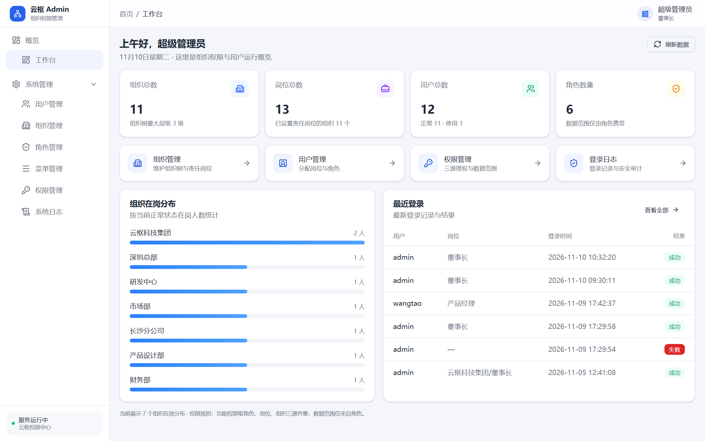
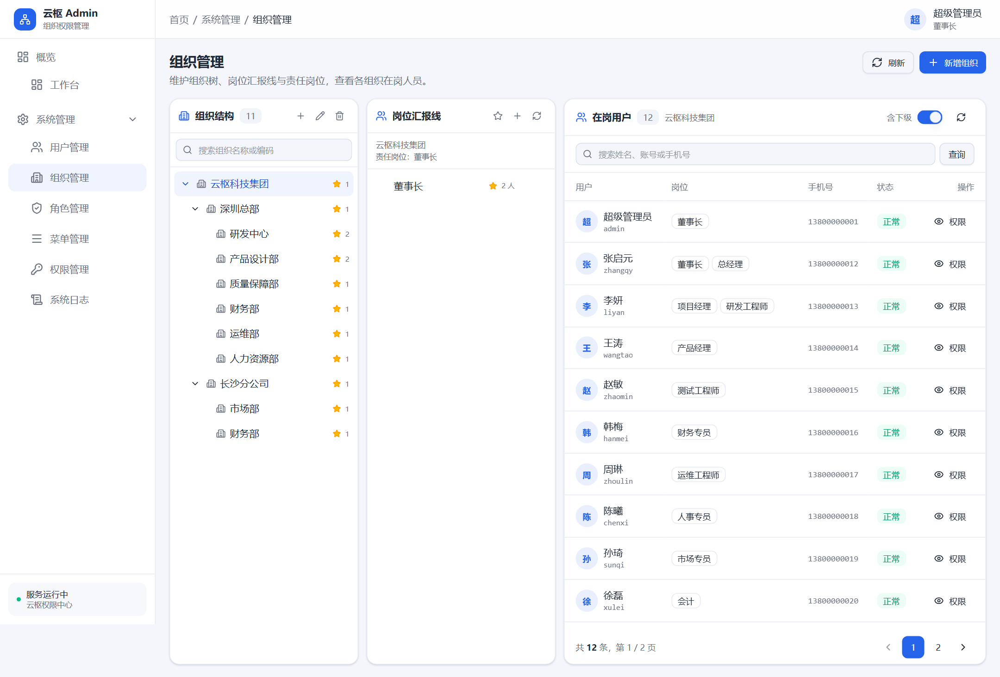
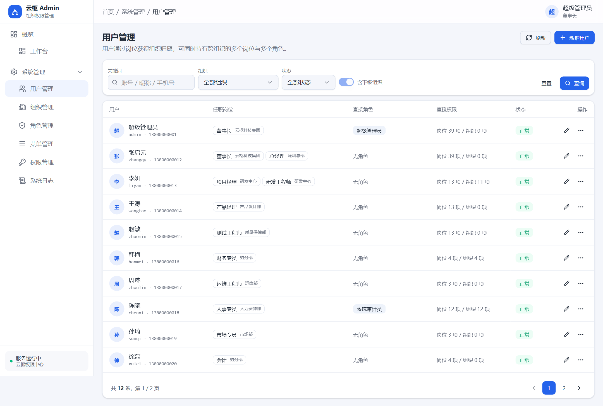
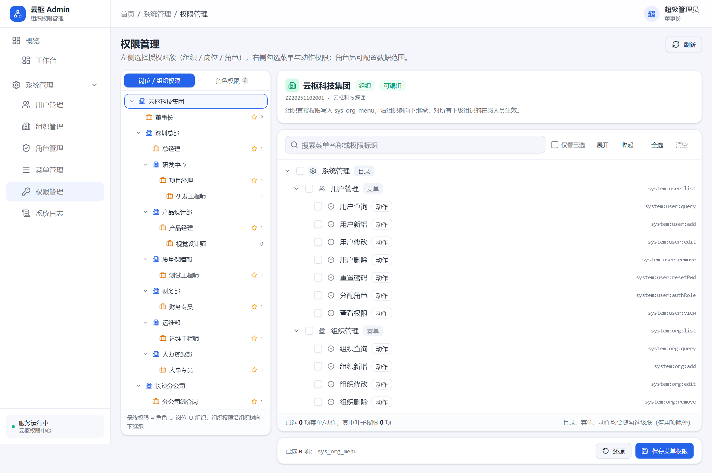
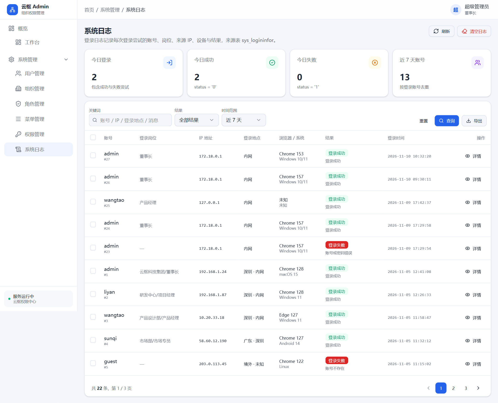

# 云枢 Admin · CloudHub

> 面向组织与岗位的组织权限管理系统：功能权限 = 角色 ∪ 岗位 ∪ 组织，数据范围只来源于角色。



## 功能特性

- **组织与岗位**：最多 9 级组织树，权限沿祖级路径向下继承；用户多岗位、可跨组织，组织归属由岗位推导。
- **三源授权**：角色、岗位、组织三种来源授予菜单与动作权限，取并集；角色额外携带数据范围（全部、自定义、本组织、本组织及以下、仅本人）。
- **动态菜单**：目录 / 菜单 / 动作三级模型，登录后按权限注册路由与侧边栏，按钮级权限统一走 `PERMS`。
- **日常管理**：用户、角色、菜单、组织与登录日志的查询、维护与审计。
- **登录日志**：按关键词、结果、时间范围筛选，支持详情、CSV 导出、批量删除与清空。

## 页面预览

| 组织管理 | 用户管理 |
| --- | --- |
|  |  |

| 权限管理 | 系统日志 |
| --- | --- |
|  |  |

## 技术栈

- **前端**：Vue 3、TypeScript、Vite、Pinia、Vue Router、Tailwind CSS v4、shadcn-vue 风格组件
- **后端**：Node.js、Hono、Zod、Drizzle ORM、MySQL、JWT
- **工程**：pnpm workspace + Turbo，Docker Compose 部署

## 快速开始

```bash
# Docker 一键启动（需 PowerShell），首次会自动初始化数据库
pwsh ./manage.ps1 up
```

访问 <http://localhost:8080>，演示账号 `admin` / `admin123`。

本地开发：

```bash
pwsh ./manage.ps1 up -Target mysql

cd admin-monorepo
pnpm install
cp apps/api/.env.example apps/api/.env
pnpm --filter @cloudhub/api dev     # http://localhost:3000
pnpm --filter @cloudhub/web dev     # http://localhost:5173
```

## 目录结构

```text
cloudhub_admin/
├── admin-monorepo/
│   ├── apps/
│   │   ├── api/      # Hono API：routes / controllers / services / sql
│   │   └── web/      # Vue 3 管理端
│   └── packages/     # db、types、utils、ui、eslint/tsconfig 共享包
├── doc/              # 数据库脚本、原型与截图
├── scripts/          # Docker Compose 与环境变量示例
└── manage.ps1        # 启动、构建、日志等运维入口
```

## 文档

- [CLAUDE.md](CLAUDE.md)：权限模型、分层约定与开发规范
- [doc/cloudhub_admin_v1.sql](doc/cloudhub_admin_v1.sql)：权威数据结构与种子数据
- [doc/cloudhub_admin_v1.html](doc/cloudhub_admin_v1.html)：交互原型
- [scripts/docker-compose.yml](scripts/docker-compose.yml)：容器编排

## License

[MIT](LICENSE)
